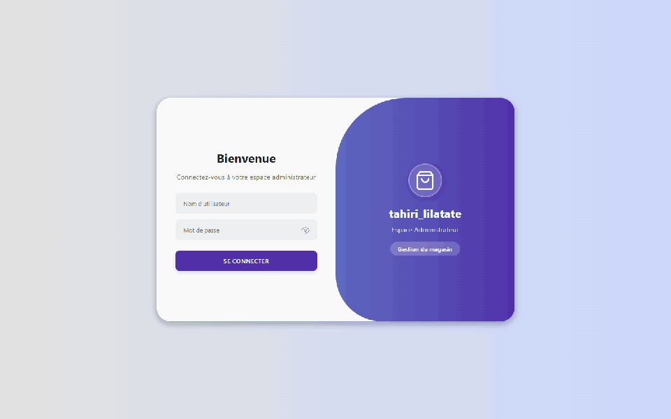
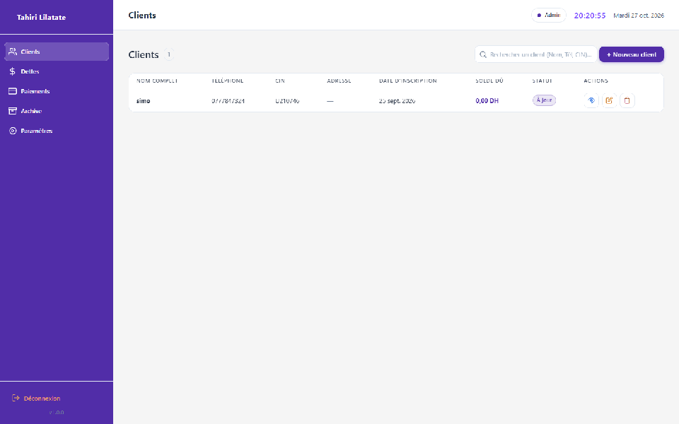
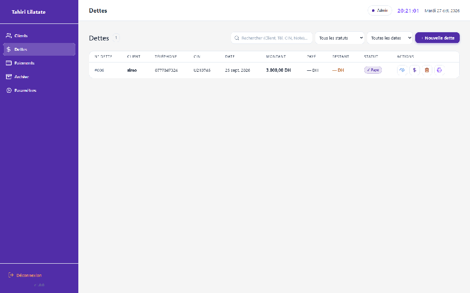
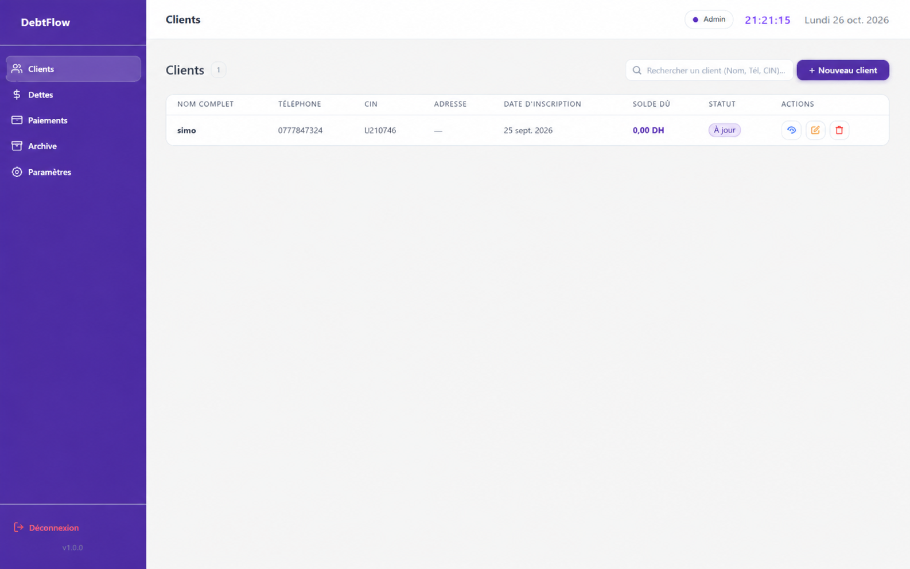
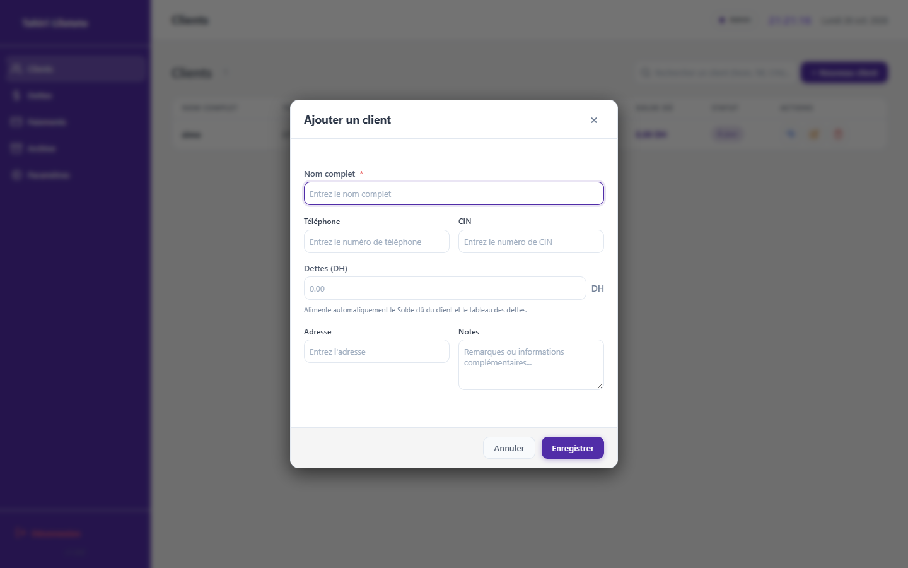
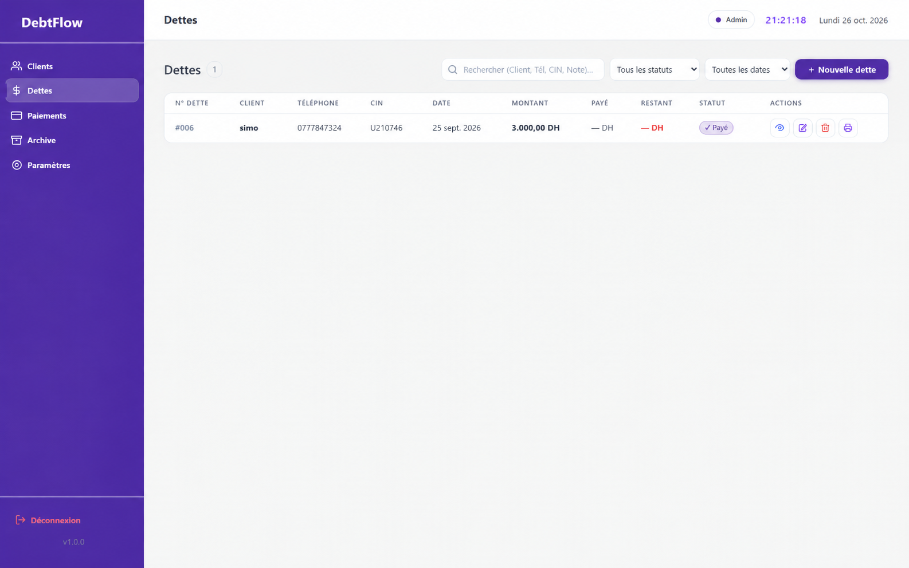
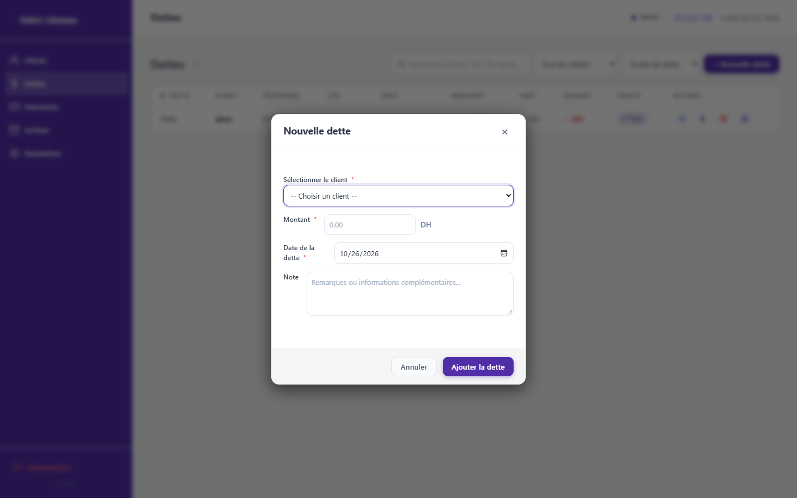
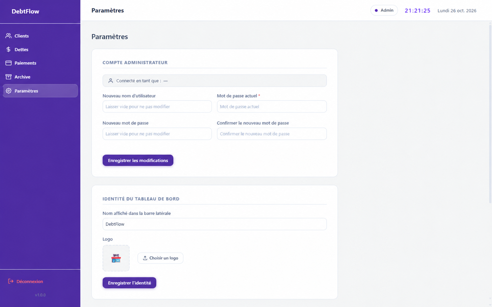

<div align="center">


<br/>

<a href="https://github.com/Ait-Momed/DebtFlow/releases"></a>


<br/><br/>

### 💼 Organisez les dettes. Suivez les paiements. Gardez le contrôle.

**Une solution logicielle de bureau robuste pour moderniser la gestion financière et le suivi des créances clients.**

<br/>

[💜 Présentation](#-présentation) ·
[✨ Fonctionnalités](#-fonctionnalités) ·
[🎬 Démonstrations](#-démonstrations-animées) ·
[🖼️ Captures d'écran](#-captures-décran) ·
[📥 Téléchargement](#-téléchargement--déploiement) ·
[🧰 Technologies](#-technologies-utilisées) ·
[🚀 Installation](#-installation--compilation) ·
[👨‍💻 Auteur](#-auteur)

<br/><br/>

<a href="https://github.com/Ait-Momed/DebtFlow/releases/latest">
  
</a>
&nbsp;&nbsp;
<a href="https://github.com/Ait-Momed/DebtFlow">
  
</a>

</div>

---

<span id="presentation"></span>
## 💜 Présentation

**DebtFlow** est une application de bureau (Desktop) performante et élégante, développée pour simplifier et informatiser la gestion des carnets de dettes, crédits clients et règlements au sein des commerces, grossistes et entreprises.

Fini les carnets papier risquant d'être égarés ou détériorés : l'application centralise l'annuaire de vos clients, l'enregistrement précis de leurs dettes, le suivi des versements partiels ou totaux, ainsi que l'impression immédiate de reçus justificatifs.

Conçue avec une architecture **hybride WPF + WebView2** et propulsée par un moteur **SQLite embarqué**, elle fonctionne **100% hors-ligne**, sans aucun abonnement, serveur distant ni connexion Internet obligatoire.

---

<span id="fonctionnalites"></span>
## ✨ Fonctionnalités

| Fonctionnalité | Description |
|---|---|
| 👥 **Gestion complète des clients** | Création, édition, recherche multicritère (Nom, Téléphone, CIN) et consultation du solde restant dû par client en temps réel. |
| 💳 **Registre dynamique des dettes** | Enregistrement de dettes avec date, montant initial, échéance, description détaillée et calcul automatique du restant dû. |
| 💰 **Gestion des encaissements & paiements** | Saisie des versements (espèces, virement, chèque), suivi de l'historique chronologique et statuts en temps réel (*Payé*, *Partiel*, *Non payé*). |
| 🖨️ **Impression instantanée de reçus** | Génération et impression automatique de tickets et reçus de versement pour les clients. |
| 📊 **Tableau de bord & Statistiques** | Vue d'ensemble financière : total des créances en cours, sommes recouvrées et clients débiteurs prioritaires. |
| 🗄️ **Module d'archivage sécurisé** | Archivage des dossiers soldés pour conserver un historique pérenne sans encombrer la vue active. |
| 🔐 **Authentification & Sécurité** | Accès protégé par mot de passe avec hachage cryptographique **PBKDF2** haute sécurité. |
| 🎨 **Interface moderne & personnalisable** | Interface épurée avec sidebar ergonomique, prise en charge de thèmes visuels et navigation ultra-rapide. |
| 📴 **100% Autonome & Hors-ligne** | Toutes vos données restent stockées localement sur votre machine dans une base SQLite légère et sécurisée. |

---

<span id="demonstrations"></span>
## 🎬 Démonstrations animées

### 1️⃣ Visite guidée complète de l'application
> *Navigation fluide à travers les différents modules : Connexion sécurisée, Liste des clients, Registre des dettes, Versements, Archives et Paramètres généraux.*

<div align="center">
  
  <br/>
  <sub>Aperçu complet du flux de travail et de la fluidité de l'interface</sub>
</div>

<br/>

### 2️⃣ Ajout d'un nouveau client & initialisation du crédit
> *Formulaire modal réactif permettant d'enregistrer un client (nom complet, téléphone, CIN, adresse) et sa dette initiale en quelques secondes.*

<div align="center">
  
  <br/>
  <sub>Création rapide avec validation instantanée des champs</sub>
</div>

<br/>

### 3️⃣ Gestion des dettes & Enregistrement des versements
> *Encaissement d'un acompte, recalcul instantané du solde restant dû et mise à jour automatique des badges de statut.*

<div align="center">
  
  <br/>
  <sub>Mise à jour en direct des statuts de paiement (Partiel / Payé)</sub>
</div>

---

<span id="captures"></span>
## 🖼️ Captures d’écran

<div align="center">

| 👥 Répertoire des Clients | ➕ Formulaire d'Ajout Client |
| :---: | :---: |
|  |  |

| 💳 Registre des Dettes & Échéances | 📝 Ajout d'une Dette |
| :---: | :---: |
|  |  |

| 💰 Historique des Règlements & Versements | 🗄️ Module d'Archivage |
| :---: | :---: |
|  |  |

| ⚙️ Paramètres du Système | 🔐 Écran de Connexion Sécurisé |
| :---: | :---: |
|  |  |

</div>

---

<span id="telechargement"></span>
## 📥 Téléchargement & Déploiement

Pour installer et utiliser directement **Tahiri Lilatate** sans passer par la compilation du code :

<div align="center">

<a href="https://github.com/Ait-Momed/tahiri-lilatate/releases/latest">
  
</a>

<br/><br/>

| Fichier | Plateforme | Système Requis | Type |
|---|---|---|---|
| **`Tahiri_Lilatate_Setup.exe`** | Windows (x86 / x64) | Windows 10 / 11 | Installeur autonome guidé (Inno Setup) |

</div>

### 🔑 Identifiants de connexion initiaux :
Lors de la première ouverture de l'application, utilisez les informations administrateur par défaut :
- **Nom d'utilisateur :** `admin`
- **Mot de passe :** `Admin@12345`

> 💡 *Vous pourrez modifier le mot de passe et personnaliser les réglages à tout moment dans l'onglet **Paramètres**.*

---

<span id="technologies"></span>
## 🧰 Technologies utilisées

<div align="center">


</div>

- **Backend / Noyau :** C# (.NET Framework 4.8) — architecture robuste et réactive.
- **Moteur d'affichage :** WPF avec **Microsoft.Web.WebView2** pour une interface utilisateur HTML5/CSS3/JavaScript fluide et moderne.
- **Base de données :** **SQLite** (`Microsoft.Data.Sqlite`) stockée localement dans `%LocalAppData%\tahiri_lilatate\`.
- **Sécurité :** Hachage des mots de passe par dérivation de clé **PBKDF2**.
- **Packaging & Déploiement :** **Inno Setup 6** avec détection automatique et intégration des prérequis Windows.

---

<span id="installation"></span>
## 🚀 Installation & Compilation

Pour les développeurs souhaitant explorer, compiler ou contribuer au projet :

### 1. Cloner le dépôt

```bash
git clone https://github.com/Ait-Momed/tahiri-lilatate.git
